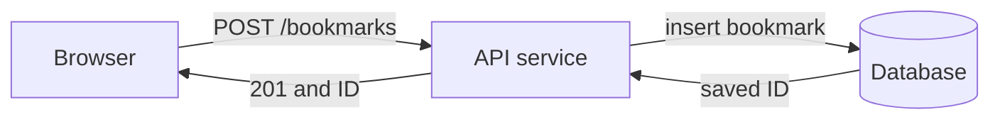

# Requests, APIs & storage

System design starts with a request and a promise to a user. You do not need dozens of services
to draw a useful first design.

## 1. Trace one request

The client sends a request. The server validates it, performs work, and returns a response.
An API is the contract between them: request fields, response fields, status codes and failure
behavior. HTTP `GET` commonly reads a resource; `POST` commonly creates one or performs an action.

## 2. Define the resource

For a bookmark, you might store `id`, `owner_id`, `url`, and `created_at`. A create request sends the
URL; a read request names the ID. A missing bookmark should produce a defined not-found result,
often HTTP 404. The service must check who owns the bookmark before returning private data.

Validation and authorization are different. A URL can be syntactically valid while the caller
still lacks permission to access the resource.

## 3. Choose where state lives

An in-process dictionary disappears when that process restarts. A persistent database can retain
data and share it across service processes. It still requires correct writes, recovery and backups.
A cache is a faster or cheaper copy of some data; decide what happens when that copy is stale or
missing. A cache is not automatically a substitute for durable storage.

## 4. Turn wishes into requirements

Functional: create a bookmark and read it later. Nonfunctional: define acceptable latency, load,
durability, freshness and access control. State assumptions instead of silently inventing scale.
"20 requests/second" measures rate. "200 ms" measures latency. Neither tells you total data size.

## Worked example: do we need a cache?

For a modest bookmark service, start with the API and an indexed database lookup. Measure read
latency, error rate and database load. Add caching only for a measured need, with a freshness rule
and invalidation plan. Extra boxes introduce extra failure and consistency decisions.

Before moving on, trace create and read requests, describe what survives a restart, and name what
a client sees if the database cannot accept a write. Your exercises apply this to saved notes.
