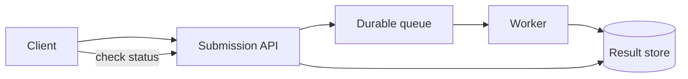

# Queues, retries & capacity

When work takes longer than an acceptable request, separate accepting it from completing it.

## 1. Queue the work

The API returns a job ID after durable acceptance. The worker processes the job later. Status
lets clients distinguish queued, running, successful and failed work. A queue absorbs bursts;
it cannot make permanently insufficient processing capacity disappear.

## 2. Expect duplicate delivery

A worker can finish an operation and crash before acknowledging it. The queue may deliver the
same job again. An idempotent operation can be repeated without additional visible effects.
A stable idempotency key identifies the logical operation, not each retry attempt.

An external email sender complicates this: a local "sent" flag and the actual send are two
separate operations. You need downstream idempotency support or must explain the remaining
duplicate/missed-send tradeoff. A queue alone does not guarantee exactly-once effects.

## 3. Bound retries and load

Retry transient failures with a delay and a limit. Exponential backoff increases the delay;
jitter spreads retries out. Invalid requests should not be retried forever. Preserve exhausted
jobs in an observable failure state so someone can investigate or deliberately replay them.

Admission control rejects or defers new work when capacity is exhausted. Define the response a
client sees and what retry behavior is appropriate; silently losing accepted jobs violates the
acceptance promise.

## 4. Calculate with units

If arrivals average 5 jobs/second and each job takes 2 seconds, average work in flight is about
`5 jobs/s * 2 s = 10 jobs` in steady state. Ten concurrent slots is an idealized fully utilized
minimum, not a robust capacity plan. Add headroom and measure service-time variation.

During overload, arrivals of 9 jobs/second and completions of 6 jobs/second grow a queue by
3 jobs/second. Over 60 seconds that is 180 additional jobs, assuming no rejection or other limits.

Watch queue depth, age of the oldest job, completion rate and errors. Each tells a different part
of the story. Your exercises address retrying notifications and a separate capacity scenario.
