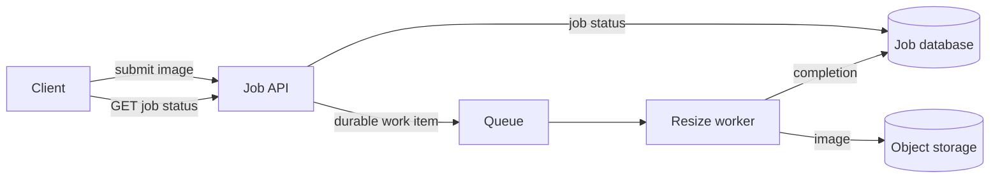

# System design: draw and defend a small system

Goal: make decisions from requirements, rather than listing technologies.

## Work from the outside in

Ask who uses the system, what a successful response means, expected load, acceptable delay,
and what data must survive a crash. State assumptions when the problem does not specify them.
Describe an API and trace one request before discussing scaling.

## Worked example: background image resizing

Assume uploads need a job ID quickly, while resized images may appear later. One possible flow:

POST /jobs returns an ID after durable acceptance; GET /jobs/id returns queued, running, done or
failed. Specify how job creation and queue publication stay consistent, for example a transactional
outbox: write a pending event with the job in one database transaction, then publish it with retries.
Do not assume two separate writes are atomic. A worker uses the job ID to avoid duplicate visible
effects when delivery is retried. Define how abandoned jobs become eligible for retry and when to
stop retrying.

If arrivals average 6 jobs/second and service takes 2 seconds, average in-flight work is about 12
jobs in steady state. Twelve slots provide no spare capacity in this idealized estimate. Real
sizing needs headroom, service-time variation, and measurements of queue wait and tail latency.

## Your diagram is part of your answer

Write Mermaid in a Markdown file alongside assumptions, arithmetic, and failure behavior.
Text arrows are equally acceptable. The browser workspace renders Mermaid diagrams in the lesson and answer preview. The terminal shows the diagram source text.
Five well-explained boxes are more useful than twenty boxes without a request flow.

Your exercises design document summarization and then handle an arrival burst. Show units in
calculations. Discuss what happens when the database, queue or worker fails.

Common mistakes: treating a queue as unlimited, saying "exactly once" without a mechanism,
confusing average processing time with p95 end-to-end latency, and adding caches without a purpose.
